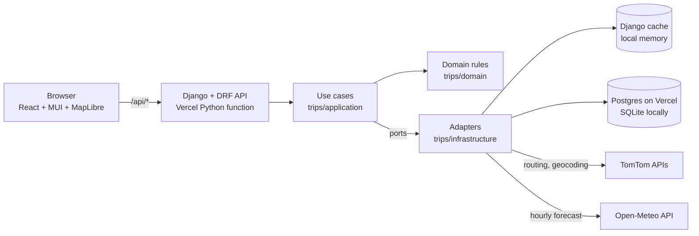
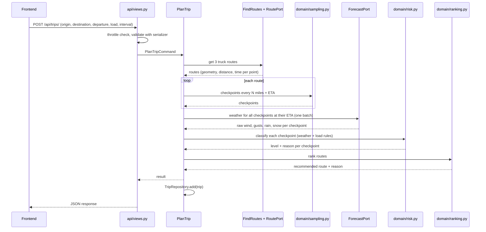
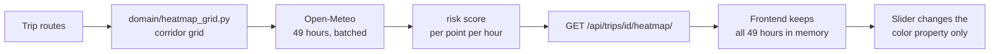
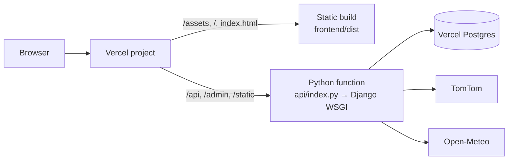

# Architecture: Route Planner

How the system is put together, how a request flows through it, and why key choices were made. Requirements live in [PRD.md](PRD.md).

---

## 1. System overview



| Part | Role |
|---|---|
| Frontend | Collects trip input, draws routes, checkpoints, cards and the heatmap |
| Interfaces (views) | Throttle per IP, validate input, call one use case, return JSON. No business logic |
| Application (use cases) | Plan a trip, build a heatmap, reopen a trip, suggest places. Talk to the outside world only through ports |
| Domain | Risk rules, checkpoint sampling, forecast-hour rules, ranking, heatmap grid. Plain Python, no framework |
| Infrastructure (adapters) | TomTom, Open-Meteo, the Django cache and the database, behind the ports |
| Cache | Avoids repeat calls to TomTom and Open-Meteo; also holds the throttle counters |
| Database | Stores trip plans so a trip can be reopened by id (Postgres in production, SQLite locally) |
| TomTom | Geocoding and truck routing (3 routes) |
| Open-Meteo | Hourly wind, gusts, rain and snowfall |

---

## 2. Trip request flow

`POST /api/trips/` is the main request. One call returns everything the map needs.



### Step details

1. **Throttle and validate:** per-IP limits (section 7), then origin ≠ destination, load 1 to 100,000 lb, departure between 15 minutes ago and 14 days ahead.
2. **Route:** TomTom `travelMode=truck`, `vehicleWeight` in kg (load plus a 35,000 lb tare), `maxAlternatives=2`. If fewer than 3 distinct routes come back, add a sideways via-point and route again.
3. **Sample:** walk each route's geometry with haversine distance; a checkpoint every 10 / 25 / 50 miles plus origin and destination.
4. **ETA:** departure + travel time interpolated from the route's own time data.
5. **Weather:** one batched Open-Meteo request (comma-separated coordinates, rounded to 0.1°). Wind uses the nearest hour; rain and snowfall read the stamp at the end of the ETA's hour, because they are preceding-hour totals. A missing wind, rain or snow value is an error (502), never calm weather.
6. **Risk:** worst of wind, rain and snow levels on the raw values, then the load rules. The payload keeps the raw values; the UI formats them.
7. **Rank:** sort by No Travel miles → Severe miles → High miles → average risk → duration. The reason sentence names the first comparison that differed, with miles to one decimal.
8. **Save and return.**

---

## 3. Heatmap flow



- **Grid:** a point every 25 km along all 3 routes plus one 30 km to each side, snapped to 0.5° cells and de-duplicated (about 250 points for a 1,000 mile trip, sized against Open-Meteo's 600 location-calls a minute).
- **Payload:** `points [[lat, lon]]`, `hours [ISO]`, `values[hour][point]` (risk score 0–4). Hour 0 is the current clock hour.
- **Why it is smooth:** the slider never calls the API. Every grid point carries all 49 scores as feature properties; the slider only changes which property colors the layer.
- **Cache:** one entry per trip and clock hour, so reopening a trip is instant and hour 0 never labels an hour that has passed.

---

## 4. Backend

### 4.1 Layout

Clean architecture in four layers inside the one Django app. Imports point inward only: `interfaces → application → domain`, and `infrastructure → application → domain`.

```
backend/
├── config/                  # settings, root urls, wsgi (also the Vercel entrypoint via api/index.py)
└── trips/
    ├── domain/              # plain Python: no Django, no HTTP, no I/O
    │   ├── entities.py      # Place, Route, Checkpoint, Conditions, Risk, RouteAssessment, Trip, Heatmap
    │   ├── risk.py          # thresholds + load rules
    │   ├── sampling.py      # checkpoints + ETA interpolation
    │   ├── forecast.py      # which forecast hour covers a moment; missing value is an error
    │   ├── ranking.py       # route metrics, ranking + reason
    │   ├── heatmap_grid.py  # corridor grid + hourly scores
    │   ├── vehicle_rules.py # vehicle weight, duplicate routes, via-points
    │   ├── geo.py           # haversine, polyline encode/decode, offsets
    │   ├── timeutil.py      # UTC helpers
    │   └── errors.py        # TripNotFound, NoRouteFound, ProviderError and friends
    ├── application/         # use cases and the ports they need
    │   ├── ports.py         # RoutePort, ForecastPort, GeocoderPort, TripRepository, CachePort
    │   ├── plan_trip.py     # routes -> checkpoints -> weather -> risk -> recommendation -> save
    │   ├── find_routes.py   # 3 distinct routes: alternatives, then via-point fallback; cached
    │   ├── build_heatmap.py # grid + 49 hours of forecast + scores; cached per trip and clock hour
    │   ├── get_trip.py, suggest_places.py
    │   ├── dto.py           # PlanTripCommand and the JSON shape of a trip (API and storage share it)
    │   └── stopwatch.py     # per-step timings for the log
    ├── infrastructure/      # adapters: everything that touches the outside
    │   ├── tomtom_routing.py, tomtom_geocoder.py
    │   ├── openmeteo_forecast.py   # batching, per-coordinate series cache, 429 handling
    │   ├── django_trip_repo.py, django_cache.py
    │   └── http.py          # one retry, and httpx errors turned into domain errors
    ├── interfaces/          # delivery: the only layer that knows DRF
    │   ├── api/             # views, serializers, throttling, exception_handler
    │   └── urls.py
    ├── container.py         # composition root: which adapter fills each port
    ├── models.py            # TripPlan (Django finds models here, so it stays at the app root)
    └── tests/               # mirrors the layers, plus fakes.py and test_architecture.py
```

### 4.2 Layer rules

- **Domain knows nothing about the world.** It imports no framework and no HTTP library. `risk`, `sampling`, `forecast`, `ranking` and `heatmap_grid` take plain data and return plain data, so they are tested without mocks.
- **Use cases depend on ports, not adapters.** `ports.py` declares what they need as structural `Protocol`s. Tests hand them in-memory fakes (`tests/fakes.py`); production wires the real adapters in `container.py`.
- **Each external service has one adapter.** `tomtom_routing.py`, `tomtom_geocoder.py` and `openmeteo_forecast.py` are the only modules that call a third-party API, through `http.py`. Every outbound call has a timeout. Routing and weather retry once on a network error or 5xx; geocoding does not retry. A 429 from Open-Meteo is not retried because its allowance resets per minute.
- **Adapters raise domain errors.** `http.py` turns every httpx failure into `ProviderTimeout` or `ProviderUnavailable` without chaining the original, because httpx puts the request URL, and with it the API key, in its messages. Nothing above infrastructure imports httpx.
- **Views are thin.** Throttle, validate, build a command, call a use case, shape the response. The exception handler maps domain errors to statuses (`TripNotFound` 404, `NoRouteFound` 422, `ForecastRateLimited` 429 with `Retry-After`, `ProviderTimeout` 504, other `ProviderError` 502), so views carry no try/except.
- **Unknown weather is never safe weather.** `domain/forecast.py` raises `ForecastMissing` when a forecast value is missing; the handler turns it into a 502 with a message.
- **The rule is enforced.** `tests/test_architecture.py` parses every import and fails if `domain` or `application` imports a framework, or if a layer imports one outside it.

### 4.3 Data model

```
TripPlan
├── id            UUID (primary key)
├── created_at    datetime
├── origin        JSON {name, lat, lon}
├── destination   JSON {name, lat, lon}
├── departure     datetime (UTC)
├── load_lb       integer
├── interval_mi   integer (10 | 25 | 50)
└── result        JSON (routes, checkpoints, recommendation)
```

The full result is stored as JSON. Trips are read whole and never queried by checkpoint, so separate tables would add complexity with no benefit.

### 4.4 API endpoints

| Method | Path | Purpose | Throttle (per IP) |
|---|---|---|---|
| GET | `/api/health/` | Health check | none |
| GET | `/api/geocode?q=` | Place suggestions | 60/min, 2000/day |
| POST | `/api/trips/` | Plan a trip | 10/min, 150/day |
| GET | `/api/trips/{id}/` | Reopen a trip | 60/min, 2000/day |
| GET | `/api/trips/{id}/heatmap/` | Heatmap data for 0–48 h | 60/min, 2000/day |

Errors: `400` for invalid input (field messages plus `detail`), `422` when no truck route exists, `429` with `Retry-After` for throttling or the Open-Meteo limit, `502` when a third-party API fails or a forecast value is missing, `504` on timeout. Every error body has a `detail` sentence the UI shows as is. Full request and response shapes are in the PRD.

---

## 5. Frontend

### 5.1 Layout

Components follow atomic design: atoms → molecules → organisms → templates → pages.

```
frontend/src/
├── api/
│   ├── client.ts              # axios instance, errorMessage(), statusOf()
│   ├── query-keys.ts
│   └── hooks/                 # useGeocode, usePlanTrip, useHeatmap (TanStack Query)
├── components/
│   ├── atoms/                 # FieldLabel, Stat, Swatch
│   ├── molecules/             # PlaceField, PresetChips, IntervalToggle, RouteCard, RiskBar,
│   │                          # Legend, HeatmapSlider, EmptyState, MapBanner
│   ├── organisms/             # TripForm, RouteList, MapView (lazy-loaded), HeatmapLayer
│   ├── templates/PlannerLayout.tsx   # sidebar + map grid; stacked below 768 px
│   └── pages/PlannerPage.tsx         # wires the form, the list, the map and the slider
├── hooks/
│   ├── use-planner-map.ts     # creates the MapLibre map, layers, popup, error state
│   └── use-debounced.ts
├── store/trip-store.ts        # Zustand: selected route (per trip), slider hour, heatmap on/off
├── theme/                     # tokens.ts (raw values), theme.ts (MUI), risk.ts (one color scale)
├── utils/                     # geo (polyline, risk segments), format, checkpoint-popup
├── constants/trip-presets.ts
├── types.ts                   # shared TypeScript types matching the API
└── main.tsx                   # providers: QueryClient, MUI theme
```

### 5.2 State

| State | Where |
|---|---|
| Server data (trip, heatmap, geocode) | TanStack Query cache |
| Selected route, slider hour, heatmap on/off | Zustand store (`store/trip-store.ts`) |
| Form values and client-side validation | Local state in `TripForm` |

The selected route is stored together with the trip id it belongs to. `useSelectedRouteId(trip)` falls back to the recommended route for any other trip, so a newly planned trip never flashes all-grey or shows the previous trip's choice.

### 5.3 Map

- Routes, risk segments, checkpoints and the heatmap are one GeoJSON source each. Updates replace source data instead of re-adding layers.
- Geometry arrives as an encoded polyline, simplified on the backend.
- The checkpoint popup opens on hover (desktop) or tap, and a tap anywhere else closes it (touch screens never fire `mouseleave`).
- Map creation is wrapped in try/catch (MapLibre throws without WebGL 2) and an `error` listener covers style load failures; either shows one banner over the map instead of a blank panel, and the route cards still work.
- The base map is OpenFreeMap "positron" vector tiles (no key; `VITE_MAP_STYLE` overrides the style URL). MapLibre, including its stylesheet, is loaded in its own chunk (`React.lazy` for `MapView` plus a vendor chunk rule in `vite.config.ts`), so the form paints before the 1 MB map library arrives.

### 5.4 Responsive layout

The MUI `md` breakpoint is set to 768 px, the PRD's tablet width. From there up the sidebar (340 px, 400 px from 1200 px) sits beside the map; below it the map takes the top half of the screen and the sidebar scrolls underneath.

---

## 6. Caching

| What | Key | Lifetime |
|---|---|---|
| Geocode results | query text | 24 h |
| Routes | origin, destination, departure hour, load | 1 h |
| Weather | rounded lat/lon, holding the whole fetched hourly series | 30 min |
| Heatmap | trip id + clock hour | 1 h |
| Throttle counters | scope + client IP | per rate window |

Django's cache framework with the local-memory backend, sized for one Open-Meteo minute of weather series. On Vercel the cache is per function instance. Switching to Redis is a settings change only.

---

## 7. Deployment



- **One Vercel project.** `vercel.json` uses the legacy `builds` form: `@vercel/static-build` for the Vite app and `@vercel/python` for `api/index.py`, with routes sending `/api`, `/admin` and `/static` to the function and everything else to the static build. The function's `maxDuration` is 60 s, passed as `config.functions` on the Python build entry because the top-level `functions` key cannot be combined with `builds`.
- **Static files:** WhiteNoise serves the Django admin's assets from the installed package; the React build is served by Vercel directly.
- **Secrets:** `TOMTOM_API_KEY`, `DJANGO_SECRET_KEY`, `ALLOWED_HOSTS`, `DATABASE_URL` and optional `CORS_ALLOWED_ORIGINS` come from environment variables only. Migrations run from a developer machine against `DATABASE_URL`.
- **Cold starts:** a second or two; the first plan is dominated by TomTom computing alternatives (about 8 s for 1,000 miles).

---

## 8. Key decisions

| Decision | Reason |
|---|---|
| TomTom for routing | Truck mode, vehicle weight, multiple alternatives on long trips. OpenRouteService's public API limits alternatives to 100 km |
| Open-Meteo for weather | Free, no key, hourly data, many coordinates per request, mph and inch units built in |
| One trip endpoint returns everything | One round trip keeps the UI fast and simple |
| Results stored as JSON | Trips are always read whole |
| Heatmap preloaded for all 49 hours | Makes the slider instant |
| Postgres on Vercel, SQLite locally | The function's filesystem is read-only, so SQLite cannot be the production store; locally it keeps setup to one command |
| Clean architecture inside one Django app | Business rules stay testable without Django or HTTP, and a provider can be swapped by writing one adapter. Costs a mapping layer (`application/dto.py`) and a composition root |
| Ports as `Protocol`s | Adapters and fakes need no base class, and the use cases never import infrastructure |
| Local-memory cache | Enough for this scope; Redis is a settings change |
| Routes cached without the interval | The interval only changes where checkpoints are placed, so one TomTom response serves all three intervals |
| Vehicle weight = load + 35,000 lb tare | Road restrictions apply to the whole truck; the risk rules still use the cargo alone |
| Missing forecast is an error | A safety tool must not present an unknown stretch as Low risk |
| Per-IP throttling | The public API otherwise lets one client exhaust the TomTom and Open-Meteo allowances |
| Sustained wind for risk, gusts shown only | Matches the brief's single wind threshold; documented in the PRD |

---

## 9. Not built yet

Where the architecture would change next. The full list, with product items, is in [PRD section 15](PRD.md#15-future-scope).

| Item | What changes |
|---|---|
| Shared cache | `CACHES` points at Redis or the database cache. Routes, weather, heatmaps and throttle counters then survive across function instances. No code change |
| One weather fetch | `PlanTrip` and `BuildHeatmap` ask the `ForecastPort` for one window per coordinate, with the heatmap grid seeded from the checkpoint cells. Roughly halves Open-Meteo usage per trip |
| Faster first plan | `TomTomRouting.calculate` sends `traffic=false`, or the view returns the direct route first and streams the alternatives |
| Reopen a trip from a link | The frontend gets a `/trips/{id}` route that calls the existing `GET /api/trips/{id}/` |
| Admin | `TripPlan` is registered in `trips/admin.py` (the file is empty today) |
| Another provider | One new adapter implementing `RoutePort`, `ForecastPort` or `GeocoderPort`, wired in `container.py`. Nothing else changes |
| Tests and CI | Frontend unit tests, a geocode endpoint test, and a workflow that runs `manage.py test`, `npm run build` and `eslint` on every push |
